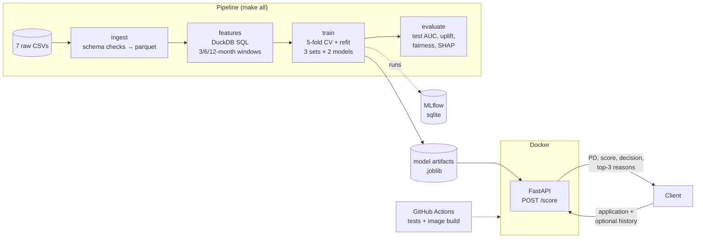

# Alternative-data credit scoring for thin-file applicants

**DSA 8401 Applied Machine Learning, capstone project.** Anne Waithera Kiragu (074432), Strathmore University.

Many adults in Kenya and across East Africa have never borrowed formally, so the credit bureau
holds no record of them ("thin-file" applicants). Lenders that rely on the bureau either reject
them or lend blindly. Lenders focused on financial inclusion, such as
[Home Credit](https://www.homecredit.net/), instead use **alternative data** (telco and
transactional information) to judge whether these people can repay. In Kenya, the richest
alternative data is mobile-money activity.

This project tests that idea on Home Credit's public data and asks three questions:

1. **Can alternative data rank thin-file risk as well as bureau data does?**
2. **Can the model explain each decision?** (reason codes for every applicant)
3. **Does it treat subgroups fairly?** (gender, age, education)

**Data.** The [Home Credit Default Risk](https://www.kaggle.com/c/home-credit-default-risk) release
(2018): 307,511 real, anonymised applications for cash loans and revolving credit, with the outcome,
across 7 relational tables (~58M rows). 14.3% of applicants have no bureau record. The public release
contains part of the alternative data Home Credit uses: **transaction records of past loans** (every
instalment due and paid, monthly card and point-of-sale balances) and a few **phone signals** on the
application form. Mobile-money logs are the same kind of data (transaction histories), but no public
dataset links them to loan outcomes, so the project tests the idea on the transaction data that exists.

## Results (test split, 61,503 applicants)

| Model | A: application | B: + behavioural | C: + bureau |
|---|---|---|---|
| WoE scorecard | 0.671 | 0.707 | 0.757 |
| LightGBM | 0.717 | 0.747 | **0.786** |
| LightGBM, thin-file only (n = 8,804) | 0.715 | 0.760 | 0.776 |

*ROC-AUC (0.5 = guessing, 1 = perfect); every step is significant on a paired bootstrap (95% CI excludes zero).*

- **Behavioural data lifts thin-file AUC from 0.715 to 0.760** (+0.044, 95% CI +0.034 to +0.056).
  Adding bureau history on top adds nothing for thin-file applicants (−0.005, 95% CI −0.010 to +0.000);
  the rest of set C's gain comes from opaque external scores (`EXT_SOURCE_*`).
- **Behaviour vs bureau, head to head.** On the 50,004 test applicants who have *both* repayment
  history and a bureau record, the two sources rank risk about equally well; neither is significantly
  better. Together they do best:

  | LightGBM, same 50,004 applicants (external scores excluded) | AUC (95% CI) |
  |---|---|
  | Application form only | 0.714 (0.705–0.722) |
  | Form + repayment behaviour | 0.743 (0.735–0.752) |
  | Form + bureau history | 0.748 (0.739–0.756) |
  | Form + behaviour + bureau history | 0.762 (0.755–0.770) |

  Behaviour minus bureau history: −0.005 (95% CI −0.011 to +0.002). This is the direct evidence that a
  lender with repayment behaviour can score people about as well as one that buys a bureau record.
- **LightGBM beats the scorecard on every set** (+0.03 to +0.05 AUC, larger for thin-file).
  The scorecard remains as the transparent, points-based alternative.
- **Decision rule:** at the cost-optimal threshold (decline if PD ≥ 15.2%, 5:1 cost ratio) the model
  approves 86% of applicants, cuts the default rate among approved loans from 8.1% to 5.1%,
  and lowers expected cost by 20% against approving everyone. Its confusion matrix on the test split:

  | | Approved | Declined |
  |---|---|---|
  | **Repaid** | 50,114 | 6,424 |
  | **Defaulted** | 2,686 | 2,279 |

  It declines 46% of defaulters while turning away 11% of good customers (`reports/confusion_matrix.csv`).
- **Fairness:** AUC is 0.75–0.79 in every gender, age and education group and probabilities
  are calibrated within groups. Applicants under 30 are approved at 0.79× the rate of the
  over-60s, just below the four-fifths line; removing age from the model does not help them.
- **Leakage audit:** bureau-free sets predict thin-file status with only AUC 0.65–0.67 and no
  single feature above 0.80 (`reports/leakage_audit.json`).

Full write-up: `reports/REPORT.pdf`. Metrics tables and figures: [`reports/`](reports/).

## Walkthrough notebook

[`notebooks/capstone_notebook.ipynb`](notebooks/capstone_notebook.ipynb) is the readable version of
the project. It follows the course's end-to-end ML cycle, as in the class practical: problem →
data → data quality → EDA → feature engineering → leakage, class imbalance and the WoE pipeline →
WoE scorecard and LightGBM on sets A/B/C → the behaviour-vs-bureau head-to-head → cost-based
decisions, confusion matrix and sensitivity → explanations and fairness → decision aid and loan
terms → limitations.

It is self-contained (plain pandas and scikit-learn, no project package), reads the CSVs from
`data/raw/`, and runs in about 12 minutes with ~3.5 GB of RAM. Its feature code is simpler than the
pipeline's, so its AUCs differ from the table above in the second or third decimal; the conclusions
are the same. Open and run it in VS Code or Jupyter; `make notebook` runs it from the command line
and writes an HTML copy.

## Architecture



**One feature code path for training and serving.** The API receives an applicant's raw
records (application form plus whatever history exists) and runs the *same* DuckDB SQL
used in training on them. A thin-file applicant simply arrives with no bureau rows, exactly
as thin-file applicants look in training, so there is no training/serving skew.

## Repository layout

```
configs/config.yaml          single source of truth (paths, windows, model params, costs)
src/thinfile/
  ingest.py                  raw CSV → validated, typed parquet (+ table schemas for serving)
  features/application.py    application-form cleaning + ratios        (feature set A)
  features/behavioural.py    instalments, POS, card, past applications (feature set B)
  features/bureau.py         bureau + bureau monthly status            (feature set C)
  features/build.py          joins everything; batch and single-request entry points
  models/woe.py              WoE binning + logistic scorecard (from scratch)
  models/lgbm.py             LightGBM wrapper with TreeSHAP reason codes
  audit.py                   leakage audit: can bureau-free sets identify thin-file applicants?
  train.py                   stratified CV → refit → test predictions, MLflow logging
  evaluate.py                metrics, uplift tests, head-to-head, confusion matrix, fairness, figures
  predict.py                 Scorer: raw records → PD, score, decision, reasons
  monitor.py                 PSI drift report on the score and every feature
api/app.py                   FastAPI service
tests/                       unit + API contract tests on synthetic data
artifacts/models/            trained models (committed so the image builds without retraining)
reports/                     metrics tables, figures, final report
examples/                    sample API requests built from real test-split applicants
notebooks/                   capstone_notebook.ipynb: the readable walkthrough (+ HTML export)
scripts/make_examples.py     builds the example API requests
```

## Reproducing from scratch

Requires Python 3.13 and ~8 GB RAM. Full pipeline runtime is about 45 minutes on 2 CPU cores
(10 LightGBM and 3 scorecard models, each with 5-fold CV). Reruns are bit-identical: features are
built single-threaded and sorted by applicant, and LightGBM runs in deterministic mode.

```bash
git clone <this repo> && cd thinfile-credit
python -m venv .venv && source .venv/bin/activate
make setup

# Download the competition data from Kaggle and put the 7 CSVs in data/raw/:
#   application_train.csv  bureau.csv  bureau_balance.csv  previous_application.csv
#   installments_payments.csv  POS_CASH_balance.csv  credit_card_balance.csv
kaggle competitions download -c home-credit-default-risk -p data/raw && unzip data/raw/*.zip -d data/raw

make all        # ingest → features → audit → train → evaluate
make test       # 16 tests, no data needed
make notebook   # optional: run the walkthrough notebook (~12 min)
make monitor    # optional: PSI drift check on a simulated thin-file-heavy batch
```

Each stage is also runnable on its own (`make ingest`, `make features`, `make train`,
`make evaluate`). Every random step is seeded from `configs/config.yaml` (`seed: 42`).
Optional tables can be removed from `data/raw/`; the pipeline then runs with those features
left missing.

Browse experiment runs with `mlflow ui --backend-store-uri sqlite:///mlflow.db`.

## Running the API

```bash
docker compose up --build              # serves the LightGBM set-C model on :8000
curl localhost:8000/health
curl -X POST localhost:8000/score -H 'Content-Type: application/json' \
     -d @examples/thin_file_applicant.json
```

Interactive docs: <http://localhost:8000/docs>. Without Docker: `make serve`.

**Request.** `application` (the form: core fields validated, all other Home Credit fields
accepted) plus optional lists `previous_application`, `installments`, `pos_cash`,
`credit_card`, `bureau`, `bureau_balance`, in raw Home Credit column format.

**Response.**

```json
{
  "SK_ID_CURR": 100021,
  "probability_of_default": 0.01885,
  "credit_score": 601,
  "decision": "approve",
  "thin_file": true,
  "top_reasons": [
    {"feature": "ORGANIZATION_TYPE", "description": "Employer type", "impact": 0.1432, "value": "Construction"},
    {"feature": "EXT_SOURCE_1", "description": "External score 1", "impact": 0.108, "value": null},
    {"feature": "INST_DPD_MEAN_ALL", "description": "Instalments: average days past due", "impact": 0.0755, "value": 2.43}
  ],
  "model_version": "lgbm_C-1.0.0",
  "latency_ms": 380.2
}
```

`decision` uses a cost-optimal threshold (approving a defaulter is assumed 5× as costly as
declining a good applicant), with a manual-review band of ±25% around it (about 10% of applicants). Other endpoints:
`GET /model-info`, `POST /score/batch` (≤500 applicants). Serve a different model with
`MODEL_NAME=scorecard_B docker compose up`.

## Documents

- [`reports/`](reports/): final report (`REPORT.pdf`), metrics tables and figures
- [`AI_USE.md`](AI_USE.md): disclosure of AI assistance
